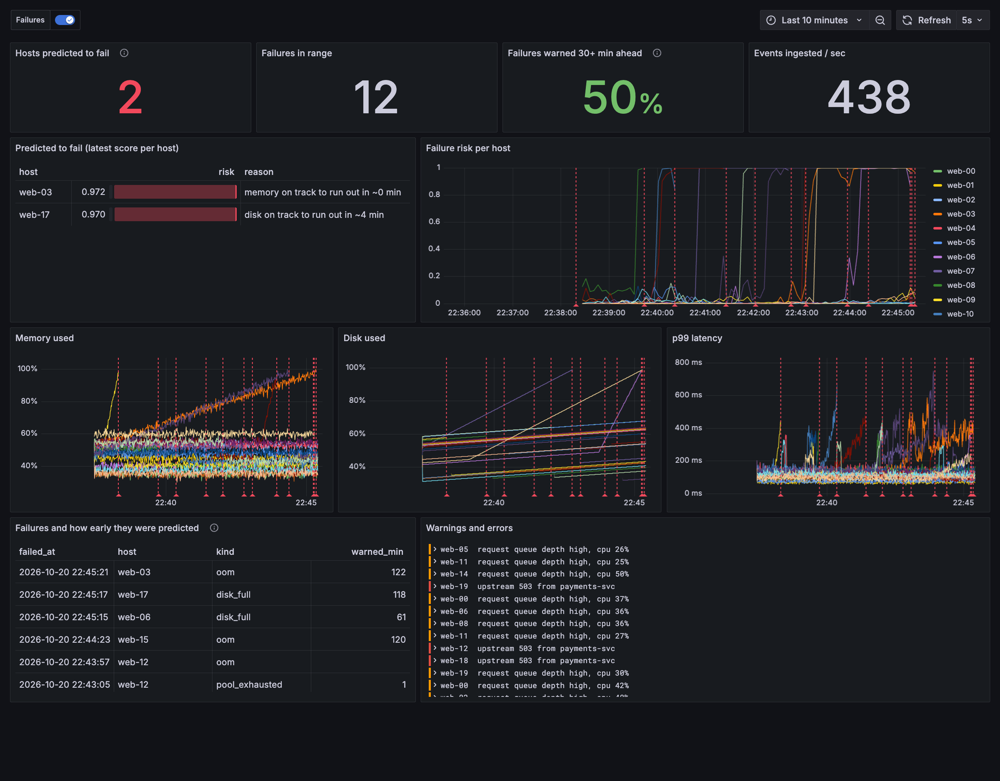
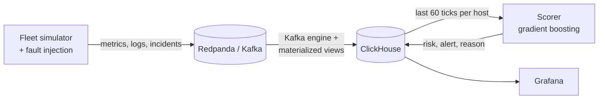

# PredictOps

**Predict host failures before they happen, from streaming metrics and logs.**

Most alerting fires when a metric crosses a line, which is usually minutes before the outage.
PredictOps watches the *shape* of the last hour of telemetry (trends, time-to-exhaustion,
warning-log rates) and flags hosts that are on their way to failing. On the benchmark below it
gives on-call engineers **2.1x more warning than static thresholds, at the same false-alarm rate**.



## Results

Model trained on one simulated fleet, threshold tuned on a second, scored on a third
(20 hosts x 7 days, 55 failures, never seen in training). The model's alert threshold is
chosen so it is *no noisier* than the static rules, so the comparison is fair.

| | failures caught | warned 30+ min early | median warning | precision | false alarms / host / day |
|---|---|---|---|---|---|
| Static thresholds (mem > 90%, disk > 90%, p99 > 500 ms, errors >= 5/min) | 100% | 51% | 36 min | 0.80 | 0.10 |
| **PredictOps model** | 96% | **78%** | **76 min** | 0.80 | 0.09 |

Reproduce with `uv run python -m predictops.train`. The 4% the model misses are the
deliberately fast faults (20 to 60 minutes from start to death), where the static rule fires too.

Pipeline throughput on a laptop (M-series, single-core Redpanda): **50,000 events/s sustained**
into ClickHouse, with the scorer reading 100 hosts' one-hour windows in **70 ms**.

## Architecture



- **Ingestion with no consumer code.** ClickHouse reads the Kafka topics itself (Kafka table engine
  plus materialized views). Nothing to write, scale or restart. See [clickhouse/init.sql](clickhouse/init.sql).
- **Storage tuned for log volume.** `LowCardinality` host/level columns, ZSTD on messages,
  `ORDER BY (host, ts)` so a per-host window read is a range scan, and 3-day TTLs.
- **One feature function.** [features.py](predictops/features.py) is used by both training and live
  scoring, so the two can't drift apart (training/serving skew).
- **Explanations people can act on.** Each prediction has a reason such as
  "memory on track to run out in ~42 min" or "p99 412ms (+6.1ms/min), 3.2 warns/min".

## The simulator, and why it exists

Real outage data with labels is rare, and you can't measure lead time without knowing exactly when
each failure happened. [sim.py](predictops/sim.py) models a fleet where one tick is one minute:

| Fault | What ramps | Precursors | Fails when |
|---|---|---|---|
| `memory_leak` | heap | GC-pause warnings, rising p99 | memory >= 98% (OOM) |
| `disk_fill` | disk usage | slow-fsync warnings | disk >= 99% |
| `conn_pool` | hidden pool utilisation | latency curve bends, then timeouts | pool exhausted |

Benign noise is there to cause false alarms on purpose: daily CPU cycles, traffic spikes,
and disk that grows slowly and is reset by log rotation. 20% of faults go from start to failure
in under an hour, so some are close to unpredictable.

## Run it

Needs Docker and [uv](https://docs.astral.sh/uv/).

```bash
docker compose up -d                                   # Redpanda, ClickHouse, Grafana
uv run python -m predictops.train                      # ~30 s: train + benchmark, writes models/
uv run python -m predictops.sim --inject web-03:memory_leak --inject web-07:disk_fill
uv run python -m predictops.predict                    # in another terminal
open http://localhost:3000                             # dashboard, refreshes every 5 s
```

The live demo runs one tick per second, so a 2-hour memory leak plays out in 2 minutes.
Load test: `--hosts 100 --info-per-tick 500` pushes about 50k events/s.

Tests: `uv run pytest` (checks the feature math, and that the model beats static thresholds on lead time).

## Limits

- Trained and tested on simulated data. The next step is to validate on a public trace, such as
  Backblaze drive SMART data or the Alibaba cluster trace.
- Log features are counts by level. Log *templates* (Drain-style mining) would catch new error types.
- Single scorer process; to scale out, shard hosts across scorers by hash.

## Roadmap

- [ ] Validate on a real public dataset
- [ ] OpenTelemetry collector input, so real services can send to it
- [ ] LLM-written incident summary per alert (what's trending, related logs, likely cause)
- [ ] Remediation agent: proposes a runbook action (restart, scale, rotate logs) and waits for a human to approve
